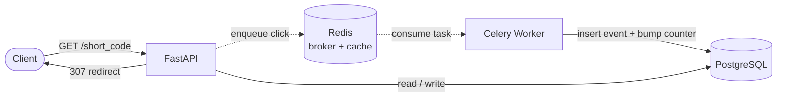

# URL Shortener

A URL shortener with asynchronous click analytics, built to explore
queue-based architecture. Click tracking and analytics run in the background
through a task queue, so recording a click never blocks the redirect response.

Built with FastAPI, PostgreSQL, Redis and Celery, fully containerized with
Docker Compose.

## Architecture

The core design goal is that recording a click must never slow down the
redirect. The redirect endpoint looks up the target URL, enqueues the click,
and responds immediately. A separate Celery worker consumes the queue and
writes analytics to PostgreSQL at its own pace.

The dotted path is asynchronous: the API returns the redirect without waiting
for the worker. If the worker is busy or down, the redirect is unaffected and
the task waits in Redis until it can be processed.
